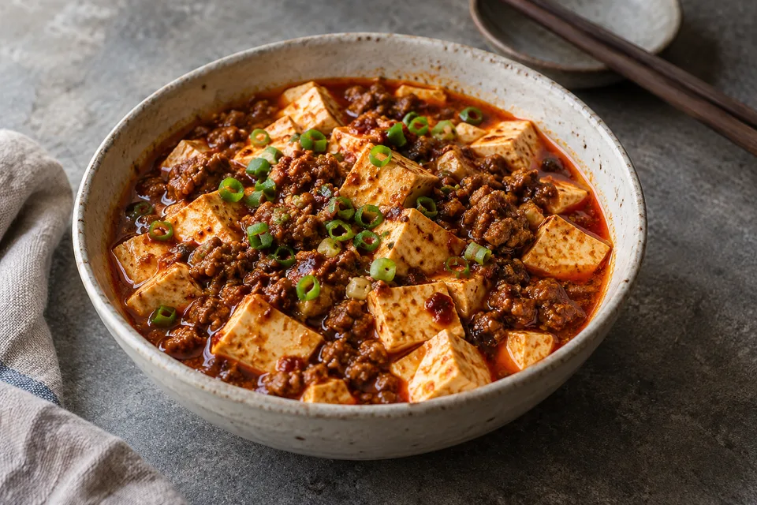

这份菜谱为演示内容，照片为项目生成素材；用量是一份示例参考，不代表主人的真实烹饪记录。

## 材料

两人份，准备约10分钟，烹饪约15分钟。

| 食材 | 用量 | 提前处理 |
| --- | --- | --- |
| 嫩豆腐 | 约400克 | 切成约2厘米的小块 |
| 肉末 | 约80克 | 牛肉或猪肉均可 |
| 豆瓣酱 | 约1汤匙 | 剁细，更容易炒出香味 |
| 蒜、姜、葱 | 按喜好 | 分开切好备用 |
| 淀粉 | 约2茶匙 | 加冷水调匀，使用前再搅一次 |
| 花椒粉 | 少量 | 临出锅时尝味后添加 |

## 备菜

- [ ] 豆腐切块，准备一碗温水。
- [ ] 姜蒜切末，葱白与葱绿分开。
- [ ] 调好水淀粉，把调味料放在手边。

与其开火以后手忙脚乱，不如先用两分钟把需要的东西都摆出来。

## 工序

### 先处理豆腐

豆腐用微沸的水温和汆烫片刻，再轻轻捞出。不要大力翻拌，后面也尽量推锅，让它保持完整。

### 炒香，再加汤

锅中放油，炒散肉末；加入豆瓣酱、姜蒜末，小火炒出香味。加入适量热水，再轻轻放入豆腐，让味道慢慢进去。

### 分次勾芡

水淀粉使用前搅匀，先放一半，观察汤汁是否挂在豆腐上；需要时再少量补充。**不要一次倒完。**

## 注意点

> 豆瓣酱本身有咸度。先尝汤汁，再决定是否加盐。

- 小火炒酱，避免颜色已经出来了，味道却焦苦。
- 保留一点汤汁，和米饭一起吃更合适。
- 花椒粉少量添加，留给每个人调整的余地。

## 下次想试

同样的用量，再比较一次老豆腐与嫩豆腐。先改变一个变量，才能知道这次更喜欢的口感来自哪里。
